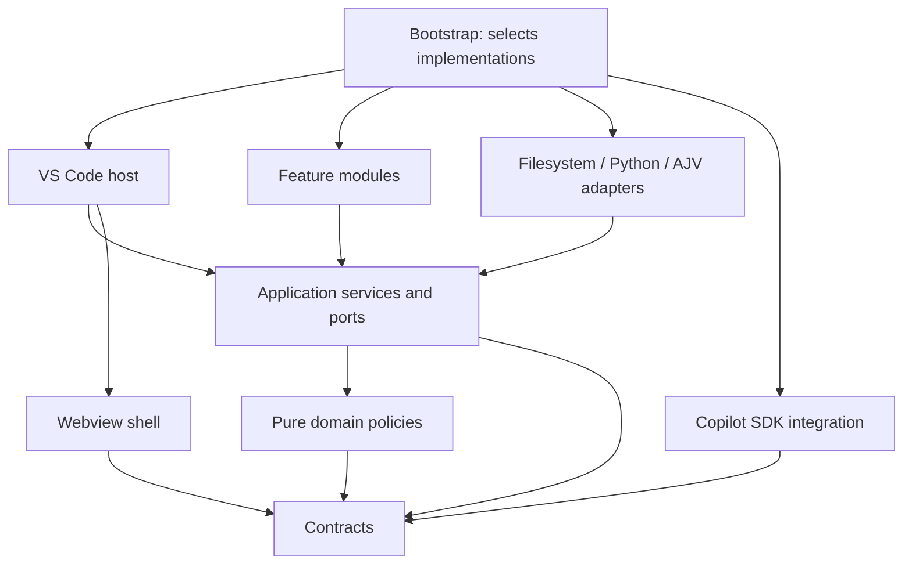

# Architecture and module boundaries

The extension has one application core and two hosts: VS Code and its browser
webview. Features are registered modules. Copilot SDK is the default executor
integration; it is selected in the composition root.

## Source map

```text
src/
  extension.ts                 VS Code entry point
  api.ts                       stable public type entry point
  contracts/                   public API and cross-boundary data types
  domain/                      pure policies, usage, limits and live-event reducer
  application/
    ports.ts                   interfaces for projects, tools, schemas and session logs
    sessions/                  provider-independent session lifecycle
    tools/                     generic tool discovery, validation and dispatch
    modules/                   module registration and contribution lifecycle
    executors/                 executor registration and discovery
    queries/                   project snapshots and historical session projection
  features/
    work-items/                tool catalog, handlers, role policy and task widgets
    metrics/                   usage summary contribution
  infrastructure/
    project/                   Python harness client, agent files and initialization
    project-tools/             JSON tool files and argv execution
    sessions/                  TSV live-log persistence
    files/                     guarded project paths
    schema/                    AJV implementation of schema validation
    process/                   subprocess execution
    scaffolding/               explicit companion-extension generator
  integrations/
    copilot-sdk/               SDK connection, native tools and event translation
  host/vscode/                 commands, workspace trust, tools bridge, API and webview host
  ui/webview/                  HTML/CSS, browser state and rendering components
  bootstrap/                   composition roots for the extension, services and demo CLI
```

## Dependency direction



| Layer | Responsibility | Allowed dependencies |
| --- | --- | --- |
| `contracts` | API v1, executor protocol, project/session DTOs | Other contracts only |
| `domain` | Role availability, executor routing, usage and state transitions | Domain + contracts |
| `application` | Coordinate sessions, module/tool registries and queries | Application + domain + contracts |
| `features` | Deliver concrete product features through modules and handlers | Core layers + the same feature |
| `infrastructure` | Implement filesystem, Python, process and validation ports | Core layers + infrastructure |
| `integrations` | Translate an external agent SDK into the executor contract | Contracts + the same integration |
| `host/vscode` | Adapt user actions, trust and native APIs to application services | Core layers + host + UI |
| `ui` | Render messages and send user intents | UI + contracts |
| `bootstrap` | Select implementations and connect the object graph | All layers |

Type-only imports are checked too. Features cannot import another feature's
internals, and integrations cannot import another integration's internals.
The HTML shell alone uses Node crypto to create its CSP nonce. Browser modules
have no Node, VS Code, application-service or storage dependencies.

## Application ports

`application/ports.ts` declares these interfaces:

- `ProjectGateway` / `ProjectAccess`: initialization, config, agents, snapshots
  and harness operations. `PythonProjectGateway` is the filesystem implementation.
- `ToolService` / `ToolRegistrar`: tool discovery, invocation and registration.
- `SchemaValidator`: schema checking; implemented by `AjvValidator`.
- `ProjectToolCatalog`: project-defined tool discovery and execution;
  implemented by `JsonProjectTools`.
- `SessionLog`: live collection, playback and finalization; implemented by
  `FileSessionLog` with the existing TSV format.
- `FileAccess`: safe file resolution for native editor commands.

`SessionRunner` receives ports and a `RuntimeHost`. It never constructs a Python
client, reads a file, or imports VS Code or Copilot SDK. It owns preflight checks,
role scope, cancellation, limits, reports and finalization. Domain policies remain
independent of storage and transport.

The tool registry only looks up, validates, authorizes and dispatches tools.
The work-items feature supplies the eight built-in tool handlers and its policy.
Reading JSON tool definitions and spawning their commands belong to infrastructure.

Live-event reduction is pure domain code. File discovery, OS process checks,
append queues and TSV persistence belong to the storage adapter. The VS Code
host selects which transcript to send to the browser; the application query
merges log-backed sessions with historical task ledgers.

Live updates carry a monotonic version and send automatic run selection together
with the transcript. The browser ignores older stream payloads, including those
from a slower full snapshot. Progress and cancellation stay in the workbench.
The Copilot adapter observes completion events independently of the SDK RPC:
idle ends the wait immediately; a final main-agent response followed by turn-end
can recover a missing idle after a short grace period. Tool turns and subagents
cannot trigger that fallback. Provider shutdown has a bounded graceful phase
and force-stops the adapter's client if its disconnect RPC is unresponsive.

## Composition and entry points

`bootstrap/services.ts` selects concrete adapters, creates application services,
and registers these modules:

- `core.workflow`: task tools, history and lessons.
- `core.metrics`: session usage summary.
- `core.copilot`: the `copilot-sdk` executor.

`bootstrap/extension.ts` adds the VS Code host and connects UI callbacks.
`extension.ts` delegates activation to it. `bootstrap/demo.ts` exposes the small
adapter set used by the explicit demo command.

Host modules each have one purpose: workspace/trust, commands, language-model
tools, project watching, the public API, or webview lifecycle. They use application
services and file-access interfaces; they do not construct storage adapters.

## Browser boundary

The webview is ordinary ES modules:

- `state.js`: persisted selection, follow/scroll state and the message bridge.
- `dom.js`: text-only rendering helpers.
- `components/tasks.js`: task list and board.
- `components/session.js`: transcript, tool output and session controls.
- `components/modules.js`: contributed widgets, actions and module list.
- `components/inspector.js`: selected task context.
- `main.js`: event handling and component coordination.

`scripts/build-webview.mjs` bundles these into `dist/webview.js`. The composition
root loads that asset and passes it to the HTML shell. The shell injects it under
a CSP nonce; project values enter as escaped JSON and render through `textContent`.
There is no runtime web server or external script dependency.

## Extending the product

For a distributable companion, run **SDLC: Create companion module**. The new
folder contains type declarations, a tool, task widget, action and opt-in executor
example. It is created only on request and never overwrites an existing folder.
Run `npm install` and `npm run package` inside it to produce a separate VSIX.
The maintained example is `examples/quality`; `npm run example:package` builds it.

```ts
const base = vscode.extensions.getExtension<SdlcApi>(
  'project-sdlc.copilot-sdk-sdlc'
);
const api = await base!.activate();
context.subscriptions.push(api.registerModule({
  apiVersion: 1, id: 'acme.quality', title: 'Quality', version: '0.1.0',
  tools: [{ definition, invoke }],
  widgets: [{ id: 'readiness', title: 'Readiness', placement: 'task', provide }],
  actions: [{ id: 'check', title: 'Check', scope: 'task', run }],
  executors: [myExecutor]
}));
```

Registration is atomic. A collision rolls back all tools and executors in that
module. Disposal removes future discovery and UI contributions together. Active
sessions retain their captured executor until they finish. Widget providers get
copies of snapshots and an abort signal; failures are reported for that widget.
Companion code runs as trusted Extension Host code, without process isolation.

For a new built-in feature, add its catalog, policy and module under `features/`,
then register it in `bootstrap/services.ts`. Core registries do not need to change.
Native Copilot tool manifest contributions come from the work-items catalog at
build time. Companion tools are exposed to agent executors and the existing
`sdlc_project_tool` dispatcher.

For a new storage implementation, implement the corresponding application port
and select it in bootstrap. The public project workflow currently remains the
work-items/TSV model; replacing that data model is not part of API v1.

## Executors and role policy

The role describes the job; the executor describes how it runs. Implement
`AgentExecutor.createSession(request)` and return `id`, `run`, `abort`, `dispose`.
The request supplies prompts, agent/model settings, scoped tools, options,
permission/input callbacks, `AbortSignal`, and an `emit` callback.

Events are `message.delta`, `message`, `turn.start/end`, `tool.start/output/end`,
`usage`, `activity`, `error`. Usage values are increments, not accumulated totals.
Only report currencies and premium-request units when known. Honor cancellation
while creating and running a session, and clean resources on creation failure.
The neutral protocol lives in `contracts/executor.ts`; Copilot-specific details
live entirely under `integrations/copilot-sdk/`.

Select the project default through **Modules → Select default executor…**:

```json
"execution": {
  "default": "copilot-sdk",
  "roles": { "planner": "acme.local" },
  "options": { "acme.local": { "endpoint": "http://127.0.0.1:8000" } }
}
```

Precedence: explicit session `executor` → agent front matter `executor` →
`execution.roles[role]` → project default → `copilot-sdk`. Missing executors fail
clearly, without switching providers. Existing projects need no migration.
Keep secrets in the executor's SecretStorage/environment, outside project options.

`domain/agent-policy.ts` supplies the same status-based actions to UI, API and
session preflight. `workflow.agentsByStatus` controls available roles and ordering.
Historical actor IDs `sdk-role` remain stable across executor changes, preserving
existing task ownership. Limits and evidence requirements remain unchanged.

## Compatibility and verification

The runtime API remains version 1. These consumer imports remain supported:

```text
sdk/api.d.ts
sdk/types.d.ts
sdk/executor-api.d.ts
```

Declarations under `sdk/contracts/` are generated by `npm run build`; the root
entries re-export them. No application, host or SDK implementation types leak into
the package. Companion examples use the same public contract as external modules.

```sh
npm run check                 # TypeScript + architectural boundaries
npm test                      # Python engine, core, adapters and boundary guard
npm run build                 # browser asset, public types and extension bundle
npm run example:package       # independently built companion VSIX
npm run test:extension        # real VS Code Extension Host integration
npm run package               # platform VSIX
```

Rules are declared in `architecture.rules.json` and enforced by
`scripts/check-architecture.mjs`: forbidden imports, cross-feature/integration
imports, unresolved source imports and dependency cycles fail the check.
